# Pırıltı Diyarı

**Kıvılcım Bekçileri** serisinin ilk oyunu · Just A Game Studios
6–12 yaş için 2.5D aksiyon RPG · Godot 4.7

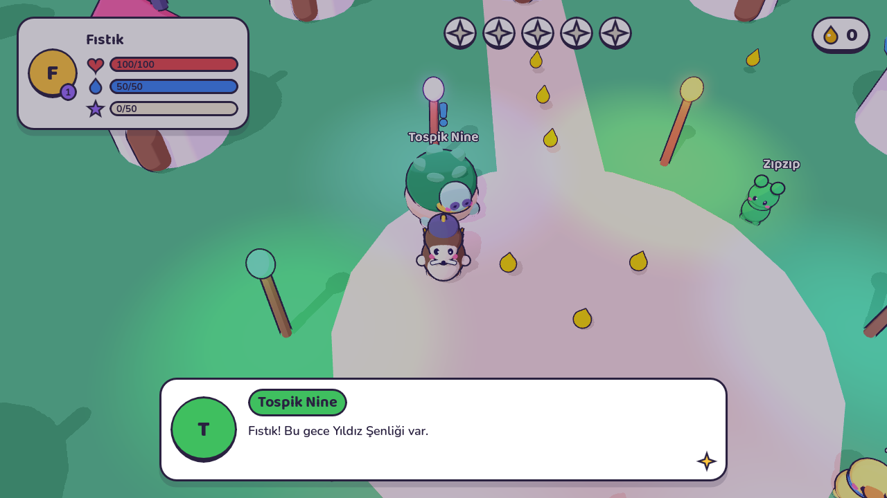

## Kaynaklar

- **Tasarım sistemi:** renkler, yazı, bileşenler, karakterler, sanat yönü
- **Hikâye:** "Oyun Hikâyesi: Prolog, Ana Hikâye ve Dünya"

`design/tokens.json` tasarım sistemindeki `tokens.json`'ın kopyasıdır. Oyun bütün renkleri, yazı boyutlarını, boşlukları ve köşeleri oradan okur. Tasarım sistemi değişince bu dosyayı yenilemek yeter.

## Çalıştırma

```bash
tools/setup_godot.sh          # Godot 4.7.2'yi .tools/ altına indirir (bir kez)
tools/test.sh                 # testler
tools/screenshot.sh out.png --scene=scene4 --at=10   # bir sahneyi açıp 10. saniyede görüntü alır
```

Editörde açmak için Godot 4.7 ile `project.godot` dosyasını aç.

### Android APK

```bash
tools/build_android.sh        # export/PiriltiDiyari.apk (debug, arm64, Android 7+)
```

Android SDK gerekmez: Godot'nun Gradle'sız dışa aktarımı kullanılır, APK
`tools/sign_apk.py` ile APK Signature Scheme v2 kullanılarak imzalanır. İmza anahtarı
`.tools/debug-key.pem` dosyasında durur (git'e girmez). Anahtar değişirse
telefondaki eski sürümü kaldırıp yenisini kurmak gerekir.

**Kontroller:** WASD / oklar yürür · Boşluk zıplar · J saldırır (diken dönüşü) · E konuşur.
Mobilde sol yarıda sanal joystick, sağda Zıpla / Saldır butonları çıkar.

## Durum

**Prolog baştan sona oynanabilir** (gri kutu modellerle), ardından Bölüm 0'ın ilk görevi:

| Sahne | İçerik | Öğretilen |
| --- | --- | --- |
| Açılış | Just A Game Studios, başlık, Başla / Devam et | |
| 1 · Yıldız Şenliği | Köy, Tospik Nine, üç çocuk, Kayıp Fenerler | yürüme, zıplama, konuşma, Pırıl |
| 2 · Gri Rüzgâr | Pus gelir, Puslu Sümüklü ve Somurtkan Mantar | saldırı, yuvarlanma, Bal Şurubu |
| 3 · Kule'ye Koşu | Düşen kirişler, sarmaşıklar, sallanan fenerler | tırmanma, platform, seviye atlama, Dikenli Dönüş |
| 4 · Pus Baykuşu | 3 fazlı boss: tüyler, dalış, sersemleme | boss dövüşü |
| 5 · Fıstık'ın Seçimi | Ara sahne: Kıvılcım beşe bölünür, Fıstık heykel olur | |
| 6 · Fener'in Seçimi | Tospik'in konuşması, bekçi seçimi, renk, aksesuar, isim | |
| Bölüm 0 | Seçilen bekçiyle: heykeli ziyaret, Dev Somurtkan Mantar | |
| Bölüm 1 · Fısıltı Ormanı | Orman Feneri, Hu, 3 fısıltı kavşağı, 3 küçük fener, Kütük Kral, Yeşil Kıvılcım | fısıltı bulmacası, halkanın üstünden zıplama |

| Bölüm 2 · Şekerleme Mağaraları | Kazma köyü, Parlak Salon, şurup nehri, Karanlık Tünel, Kıskaç'ın gölü, Mavi Kıvılcım | kristal bulmacası (vurunca yanar), karanlık, Gece teması |

| Bölüm 3 · Bulut Limanı | Bulutların üstünde 4 ada, Pırpır'ın gemisiyle yolculuk, fırtına çanları, balonlar, Rüzgâr, Sarı Kıvılcım, gölge figür | rüzgârda kayanın dibine saklanma, balonla zıplama |

| Bölüm 4 · Uyku Dağı | Teraslı karlı dağ, kamp ateşleri, Bilge Kuzey'in Mırıl hikâyesi, Dondurma, Beyaz Kıvılcım | uykulu sis, kaygan buz, yuvarlanan kar topları |

| Bölüm 5 · Pus Kalesi | Kale Feneri, 4 kıvılcım kapısı, Mırıl'ın 4 anısı, Gölge Prens Mırıl, Mor Kıvılcım | gölge kopyalar, yankı saldırıları, Faz 2: kıvılcım uzatma |
| Kapanış | Altı Renkli Fener, Fıstık uyanır, köy şenliği, kırmızı sis, Sezon 1 sonu ekranı | |

**Bölüm 5:** Kalenin dört kapısı topladığın kıvılcımları gösterince açılır (yeşil, mavi, sarı, beyaz). Odalarda
Mırıl'ın dört anısı var: oyuncak ayı, doğum günü şapkası, yıldız haritası, küçük fener. Tepede Gölge Prens Mırıl:
Faz 1'de gölge kopyalar ve önceki bossların yankıları (baykuş dalışı, halka, buz sarkıtları), her turdan sonra
yorulur ve vurulabilir. Faz 2'de dövüş yok: "Kıvılcım uzat" ile dört kıvılcım sırayla verilir, her biri bir anıyı
hatırlatır ve gölge küçülür; sonunda yıldız çocuk Mırıl ortaya çıkar ve Mor Kıvılcım bulunur. Hikâye Taşları
9–10 kalededir (toplam 10).

**Kapanış:** Beş kıvılcım Fener Kulesi'ne gider, kule gökkuşağı rengine döner, Fıstık heykelden uyanır ve bekçiye
rozet verir; köyde şenlik ve pasta. Mumlar söndüğünde ufukta kırmızı bir sis görünür. Ardından **Sezon 1 sonu
ekranı**: toplanan kıvılcımlar, taşlar, seviye, Pırıl ve "Sezon 2'de seni neler bekliyor?" listesi. "Köyde dolaş"
ile köye dönülür: heykel yerinde Fıstık, yanında Mırıl dolaşır, Tospik Nine yeni sözler söyler.

**Bölüm 4:** Dağa teras teras tırmanılır; her kamp ateşi bir sonraki rampanın uykulu sisini eritir. Zirvede
Bilge Kuzey Mırıl'ın hikâyesini anlatır: gökten düşen, kimsenin fark etmediği yalnız bir yıldız ("Pus kötülük
değil, yalnızlıktır"). Moblar: Kar Topu Tavşanı (uzaktan atar), Buz Dikeni. Buz Golem Dondurma (üç top
dondurma!) yenilince dağ erir. Yan içerik: 3 uykucu yavru, Hikâye Taşları 7–8, dört bekçi köşesi;
Bilge Kuzey toplanan taşları sayar.

**Bölüm 3:** Adalar arasında Kaptan Pırpır'ın gemisiyle uçulur ("Nereye uçalım?"). Fırtına rüzgârı oklarla
haber verilir; kaya dibinde rüzgâr işlemez. Bulutlara düşen bekçiyi Pırpır yakalar. Moblar: Fırtına Yumağı
(iter), Korsan Martı (3 Pırıl kapar, sakinleşince geri bırakır). **Pırpır'ın Nadir Pazarı:** Cesaret Şekeri
(60 sn güç), Pus Kovucu (90 sn moblar zor fark eder), Rüzgâr Tılsımı (kalıcı hız). Yan içerik: 3 martı
yavrusu, Hikâye Taşları 5–6, dört bekçi köşesi.

**Bölüm 2:** Mağaralar tasarım sisteminin Gece temasıyla oynanır; bekçi kendi ışığını taşır (Lumi'ninki daha geniş).
Moblar: Gri Kristal Böceği (yere dalıp altından çıkar), Yarasa Fısıltısı. Kıskaç dost olunca **Kazma Ailesi Dükkânı**
açılır: Pırıl ile Bal Şurubu, Yıldız Tozu ve Kristal Tılsım (+15 can) alınır. Yan içerik: Kazma'nın 3 çocuğu,
Hikâye Taşları 3–4, dört bekçi köşesi.

**Bölüm 1 yan içerik:** Kayıp Yavrular (3), Hikâye Taşları 1–2, ve her bekçiye özel bir köşe:
Pati çift zıplamayla sütuna çıkar, Bado kayayı iter, Çıtır dereye halat atar, Lumi karanlığı aydınlatır.
Köy ile orman arasında tabelalarla gidilip gelinir.

Sahne başlarında oyun kaydedilir (`user://kayit.json`); açılıştaki "Devam et" oradan sürer. Kimse ölmez: can biterse "Uykuya daldın", son yanan fenerde uyanılır.

> Pıtı, Tıpış ve Zıpzıp'ın adları ve türleri hikâye dokümanında yoktu; ben verdim.

<p>
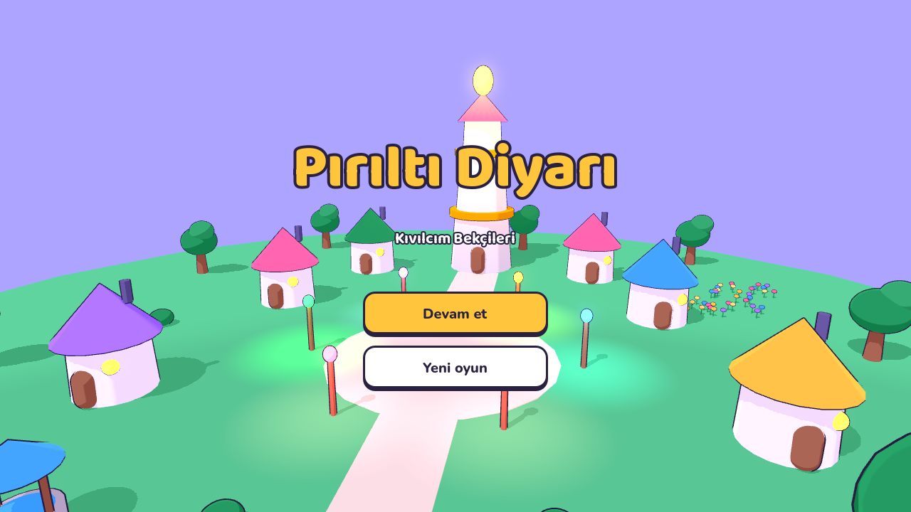 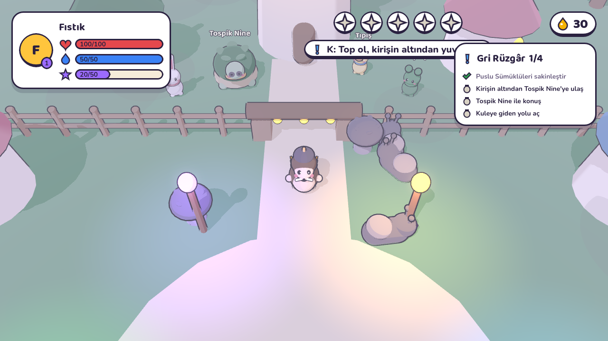
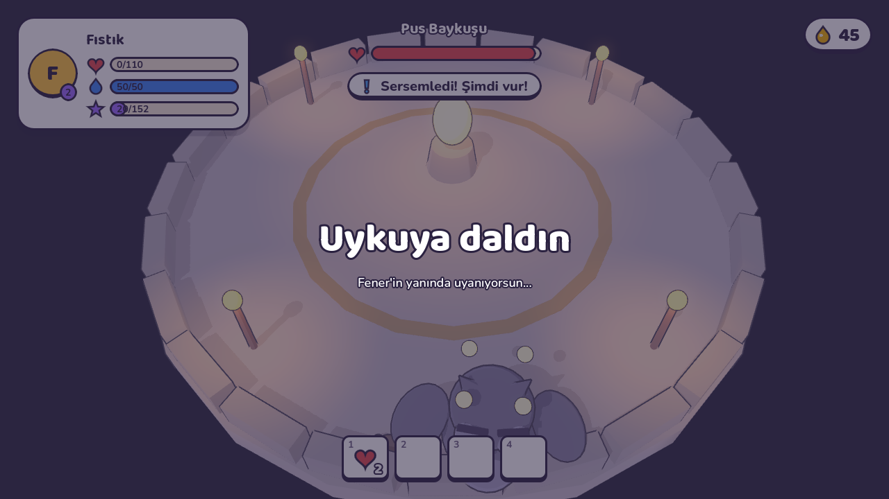 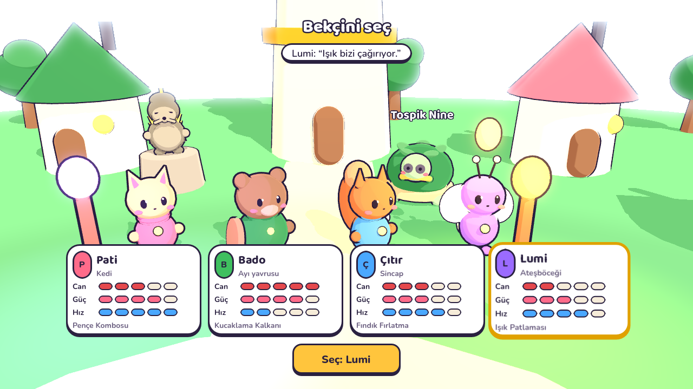
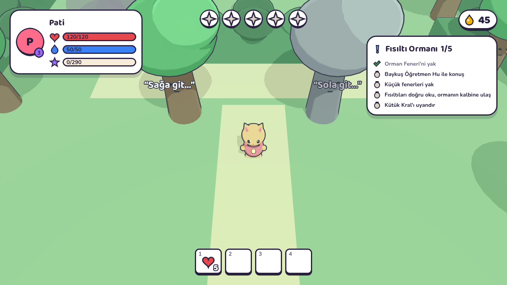 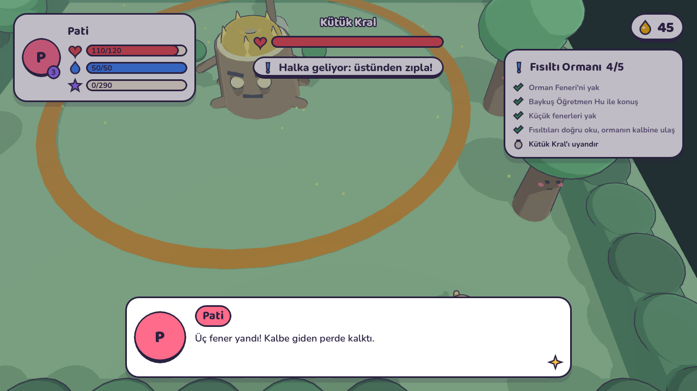
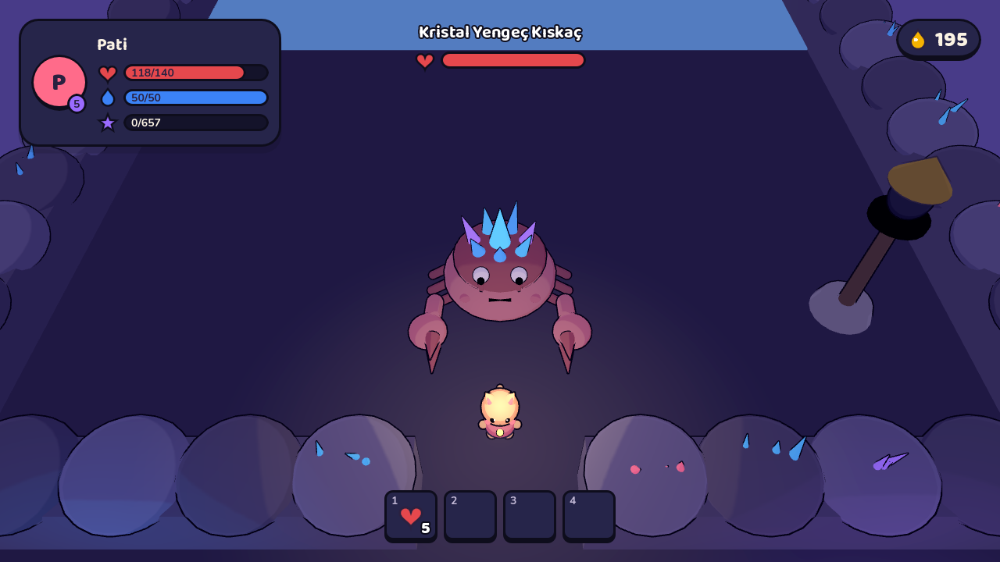 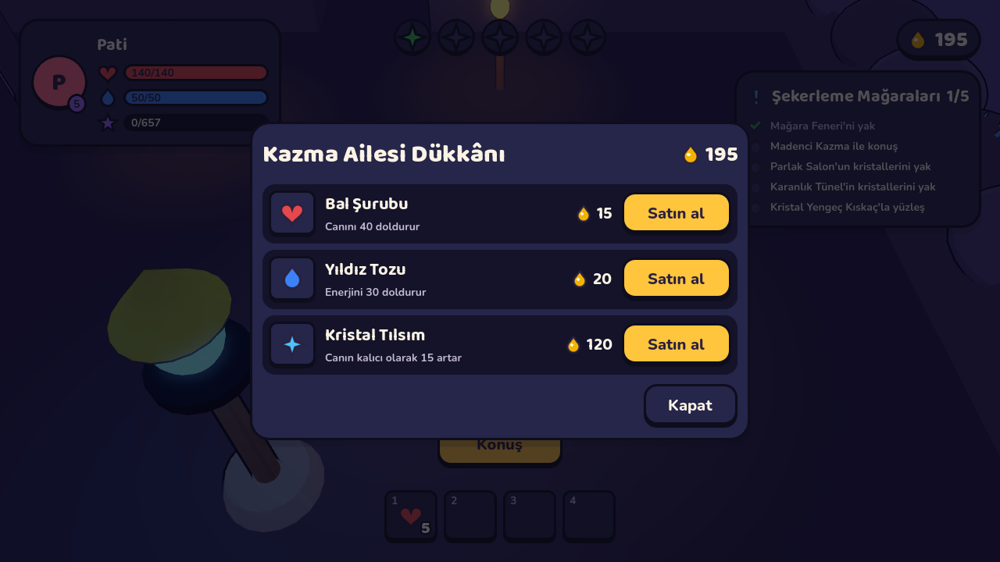
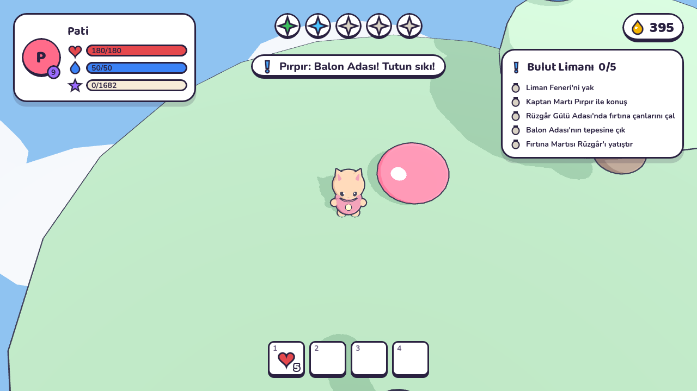 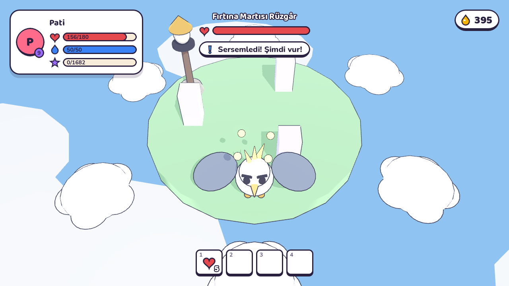
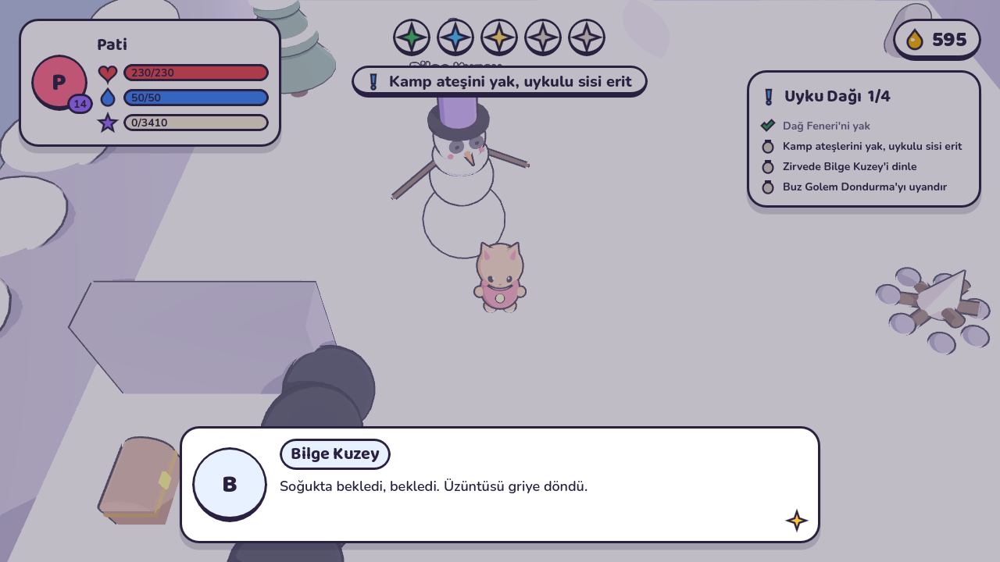 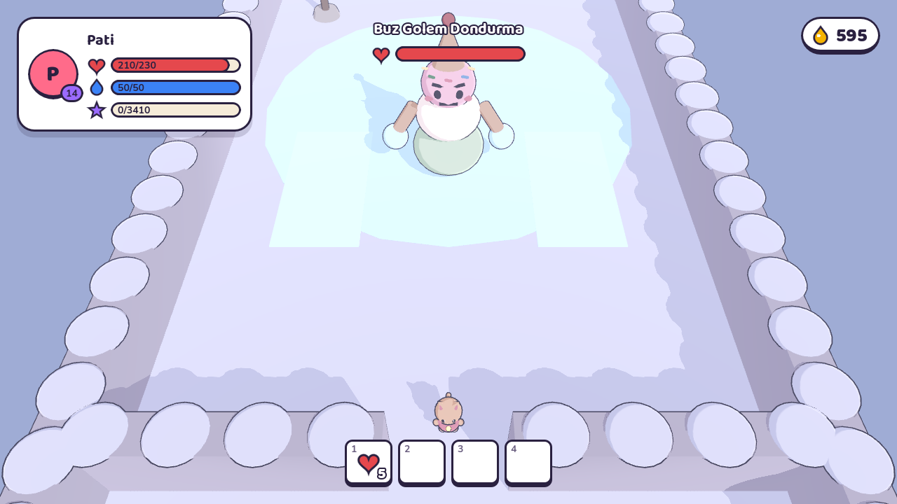
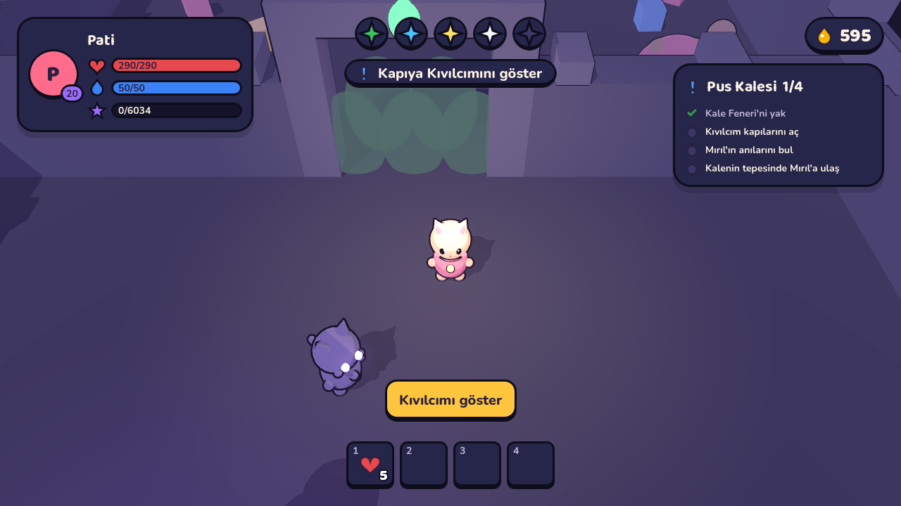 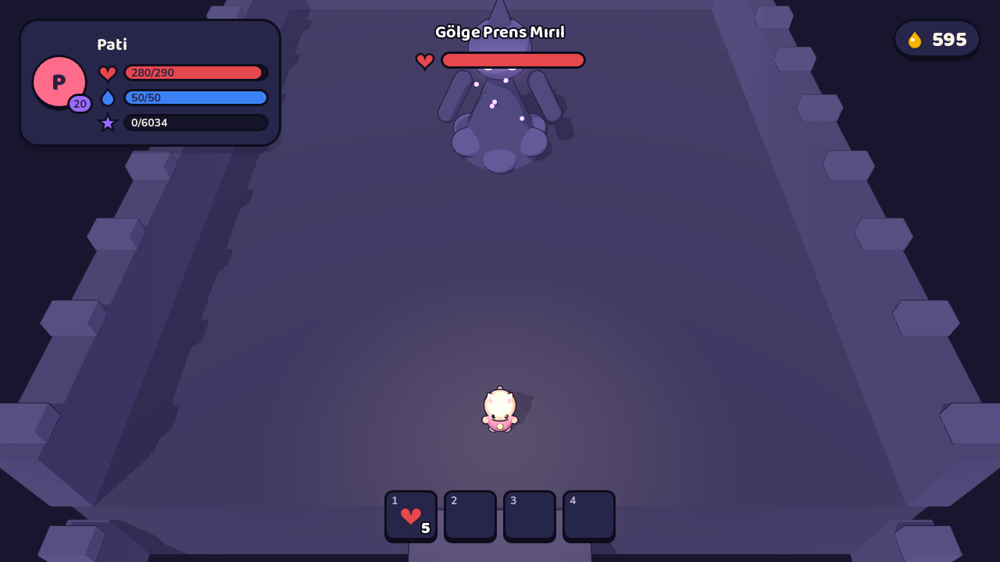
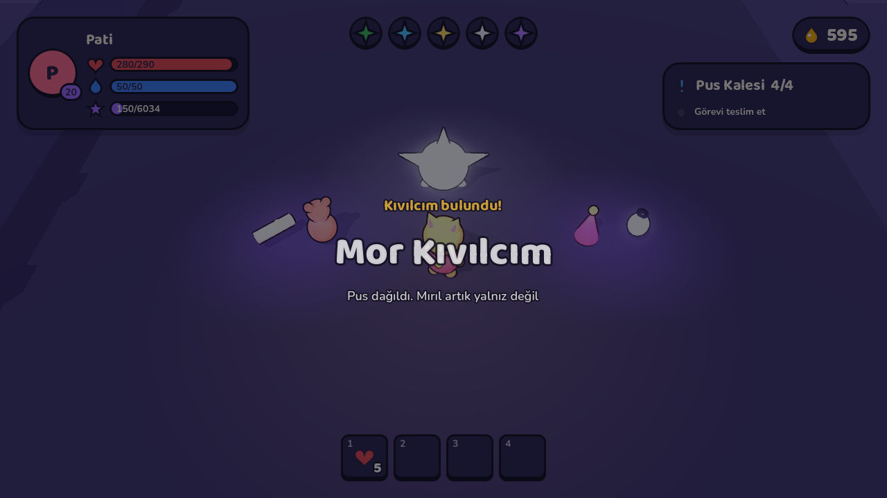 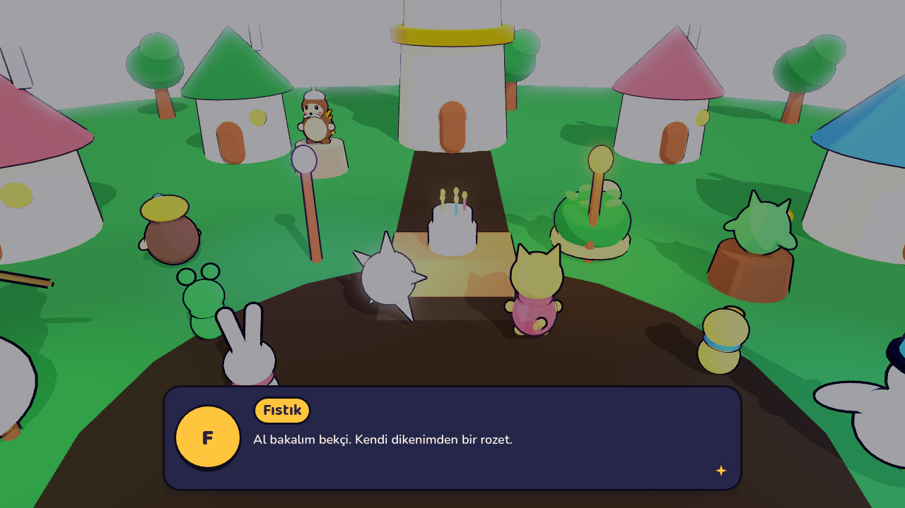
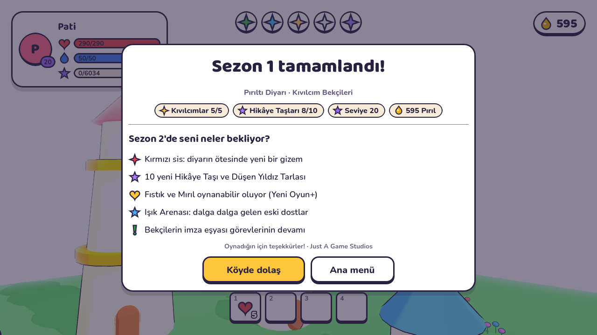 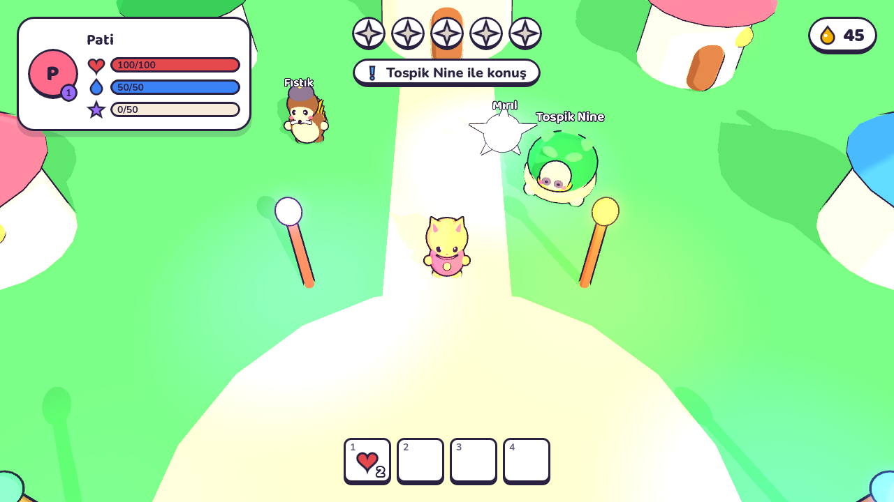
</p>

**Kontroller:** WASD / oklar · Boşluk zıpla · J saldır · K yuvarlan · L Dikenli Dönüş · E konuş · 1–4 iksir.
Mobilde: sanal joystick, Zıpla / Saldır / Yuvarlan / Dönüş butonları, iksir yuvalarına dokunma.

### Henüz olmayanlar

- Gerçek modeller, ikonlar, logo, ses ve müzik (her şey ilkel şekillerden yer tutucu)
- Envanter ekranı, ayarlar, Terzi Dikiş'in kozmetik dükkânı
- Sezon 2 (sezon sonu ekranında duyurulanlar): kırmızı sis, 10 yeni Hikâye Taşı ve Düşen Yıldız
  Tarlası, oynanabilir Fıstık ve Mırıl (Yeni Oyun+), Işık Arenası, imza eşyası görevlerinin devamı

## Proje yapısı

```
content/            hikâye verisi (bölüm paketleri) — kod değişmeden hikâye eklenir
  items.json, speakers.json
  keepers.json        dört bekçi adayı (karakterler.md'den)
  prologue/           chapter.json, quests/, dialogue/, barks.json, cutscenes/
  chapter0/           Bölüm 0 paketi
design/tokens.json  tasarım sistemi token'ları
src/autoload/       Tokens, Content, GameState, InputSetup, DevTools
src/core/           sahneden bağımsız kurallar: PlayerData, Progression, DialogueRules,
                    MobStats, OwlPlan, SaveGame
src/world/          toon shader, kamera, köy parçaları, sahne betikleri
src/actors/         oyuncu, NPC'ler, toplanabilirler (şimdilik ilkel şekillerden modeller)
src/ui/             HUD, diyalog kutusu, barlar, ikonlar, dokunmatik kontroller
scenes/             sahneler (.tscn)
tests/              ekransız testler
```

## Diyalog verisi

Her NPC'nin konuşmaları `content/<bölüm>/dialogue/<npc>.json` dosyasındadır. Koşulu (`when`) tutan ilk konuşma oynar, ardından etkisi (`then`) uygulanır. Son konuşma koşulsuz olmalı. Kurallar `src/core/dialogue_rules.gd` dosyasında, testler bunları ve yazım kurallarını (satır en fazla 70 harf, bilinen konuşan ve eşya) kontrol eder.

## Lisanslar

Baloo 2 ve Nunito: SIL Open Font License (`assets/fonts/OFL-*.txt`).
