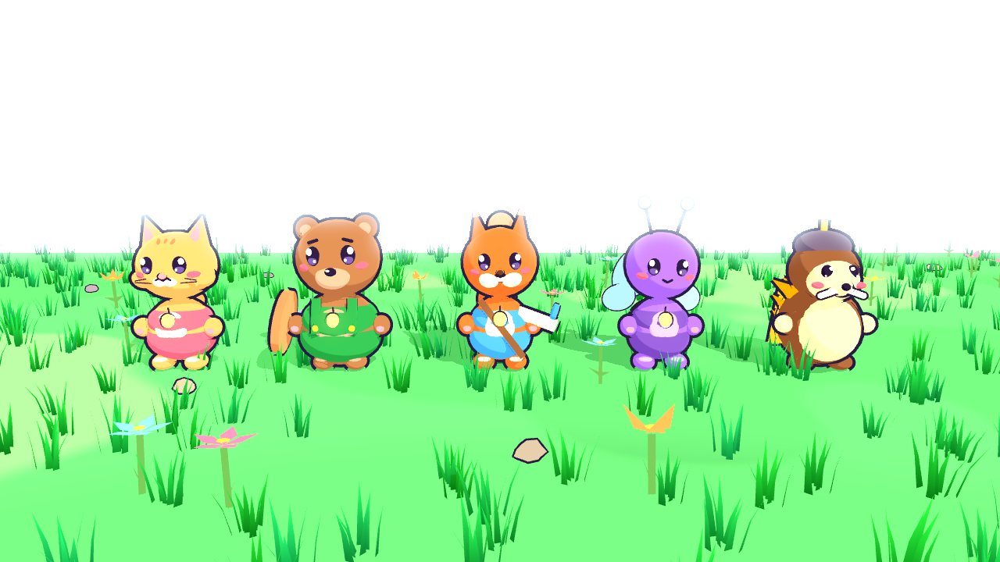
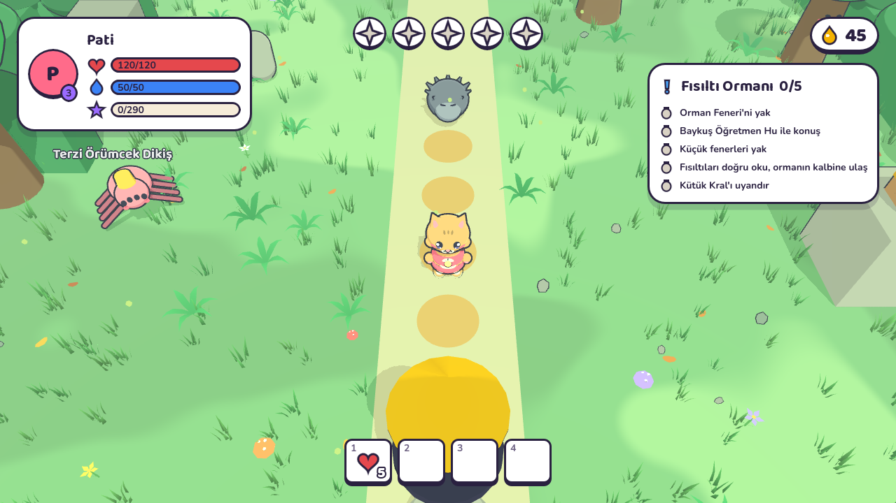
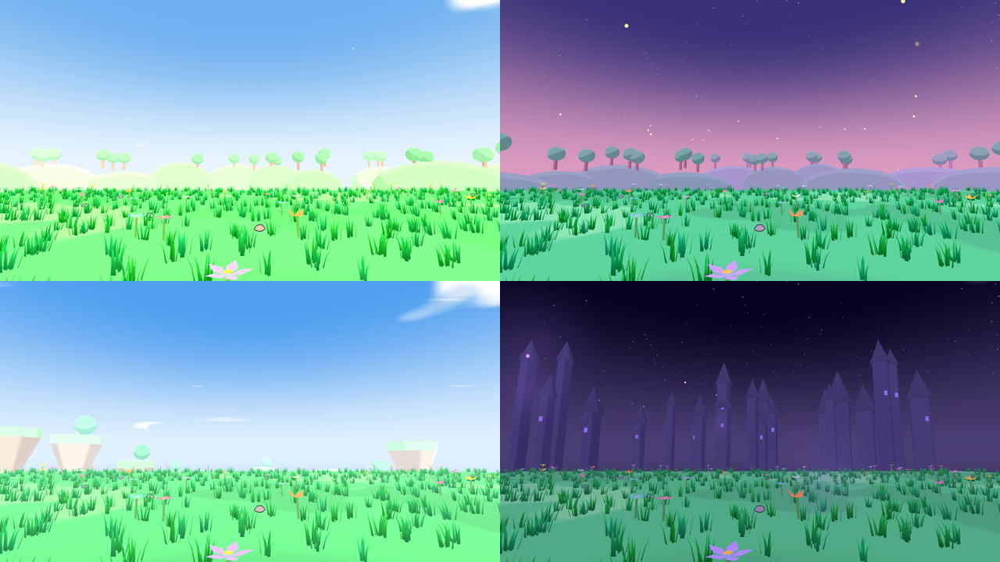
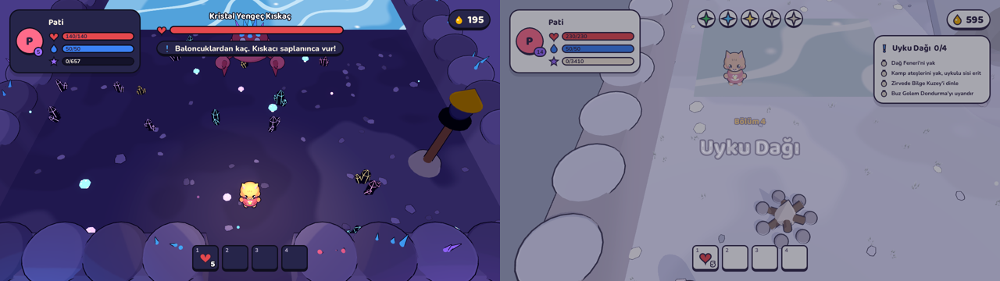
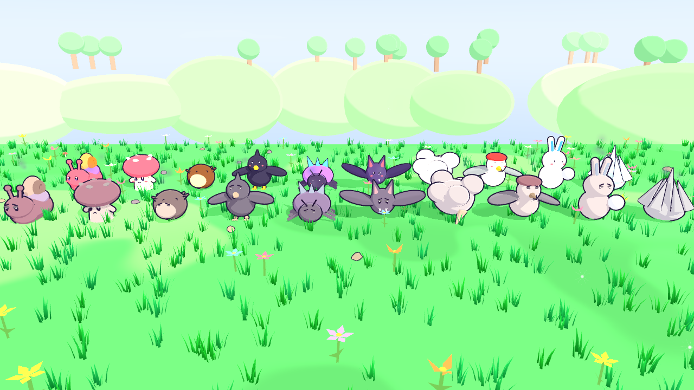
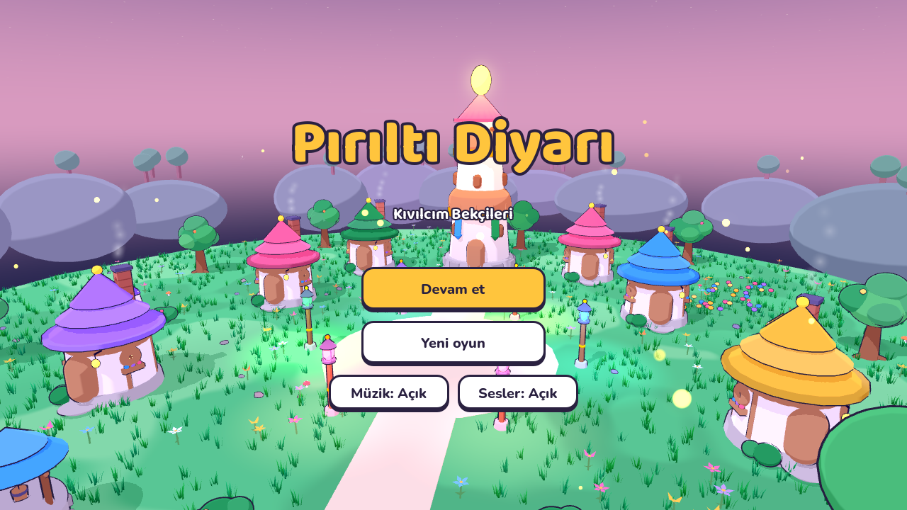
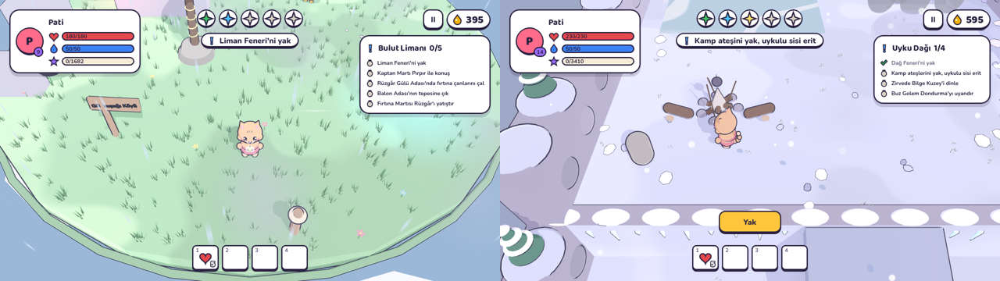
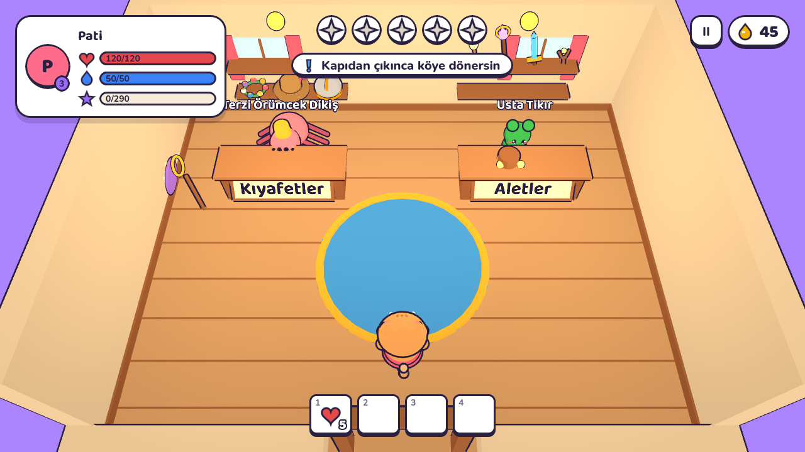
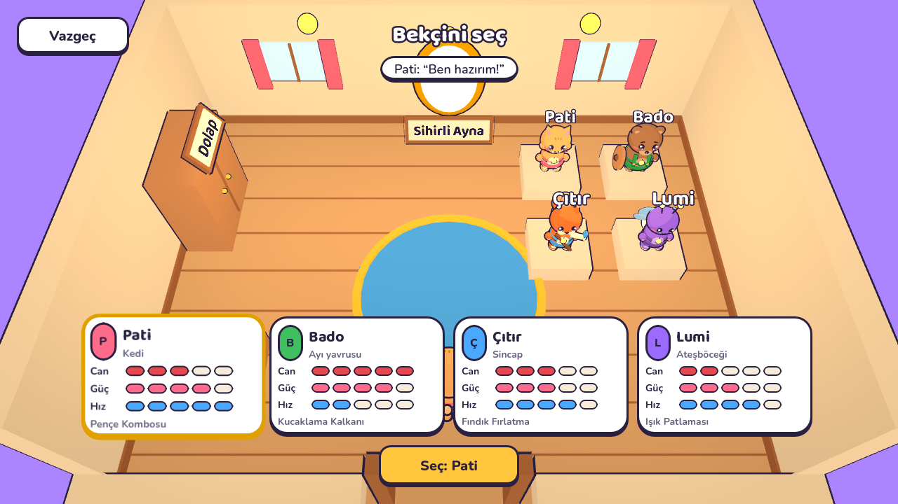
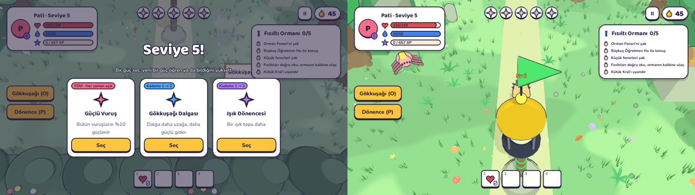

# Pırıltı Diyarı

**Kıvılcım Bekçileri** serisinin ilk oyunu · Just A Game Studios
6–12 yaş için 2.5D aksiyon RPG · Godot 4.7


## Kaynaklar

- **Tasarım sistemi:** renkler, yazı, bileşenler, karakterler, sanat yönü
- **Hikâye:** "Oyun Hikâyesi: Prolog, Ana Hikâye ve Dünya"

`design/tokens.json` tasarım sistemindeki `tokens.json`'ın kopyasıdır. Oyun bütün renkleri, yazı boyutlarını, boşlukları ve köşeleri oradan okur. Tasarım sistemi değişince bu dosyayı yenilemek yeter.

## Çalıştırma

```bash
tools/setup_godot.sh          # Godot 4.7.2'yi .tools/ altına indirir (bir kez)
tools/test.sh                 # testler
tools/screenshot.sh out.png --scene=scene4 --at=10   # bir sahneyi açıp 10. saniyede görüntü alır
```

Editörde açmak için Godot 4.7 ile `project.godot` dosyasını aç.

### Android APK

```bash
tools/build_android.sh        # export/PiriltiDiyari.apk (debug, arm64, Android 7+)
```

Android SDK gerekmez: Godot'nun Gradle'sız dışa aktarımı kullanılır, APK
`tools/sign_apk.py` ile APK Signature Scheme v2 kullanılarak imzalanır. İmza anahtarı
`.tools/debug-key.pem` dosyasında durur (git'e girmez). Anahtar değişirse
telefondaki eski sürümü kaldırıp yenisini kurmak gerekir.

**Görünüm:** Karakterler parça parça kurulur (gövde, kafa, kulak, el, ayak, kuyruk); parlak gözleri
kırpışır, nefes alır, yürürken adım atıp kol sallar, zıplarken esner. Köylülerde de göz kırpma ve nefes var.
Her sahnenin zemini kendiliğinden süslenir: çim (rüzgârda sallanır), çiçek, taş; ormanda eğrelti, mantar
ve yaprak, mağarada parlayan kristaller, dağda kar öbekleri, kalede moloz. Yollar boş kalır, süsler çarpışmaz.

**Atmosfer:** Her bölümün kendi gökyüzü var (renk geçişi, güneş/ay, kayan bulutlar, akşam ve kalede yıldızlar),
ufukta uzak tepeler, orman, uçan adalar, karlı zirveler ya da kale kuleleri. Güneşli bölümlerde zeminde bulut
gölgeleri kayar. Hava: köyde karahindiba tohumları ve akşam ateşböcekleri, ormanda süzülen yapraklar, mağarada
parlayan toz, Bulut Limanı'nda rüzgâr çizgileri ve Pus varken yağmur, dağda kar, kalede mor sis. Pus her yerde
yerde süzülen gri tüller olarak görünür; fener yandıkça tüller dağılır, gökyüzü renklenir, güneş çıkar.
Bulut Limanı temizlenince gökkuşağı belirir. Göl dalgalanır, şurup akar, buz pırıldar, bulut denizi süzülür.

**Ses ve müzik:** Her bölümün kendi müziği var (köy marimbası, ormanda flüt, mağarada yankılı çanlar,
limanda oynak bas, dağda ninni, kalede arp; boss dövüşlerinde enerjik bir parça). Pus varken müzik boğuk
duyulur, fenerler yandıkça açılır. Zıplama, vuruş, Pırıl, fener, kapı, çan, balon, sandık, hikâye taşı ve
diyalog gibi her olayın sesi var; her saldırı görsel uyarının yanında yumuşak bir "ding-ding" ile de haber
verilir. Hepsi `tools/make_audio.py` ile sentezlenir (`assets/audio/`); açılış ekranında Müzik ve Sesler
ayrı ayrı kapatılabilir.

**His ve cilalar:** Vuruşlarda "pat!" yıldızı, hafif ekran sarsıntısı ve çok kısa bir donma; can kaybında
sarsıntı. Pırıl yakındaki bekçiye mıknatıs gibi süzülür (duvar ya da yükseklik arkasından değil: bekçi
köşeleri yine yetenek ister). Koşarken ve inerken toz bulutları, dağda karda ayak izleri. Sağ üstteki
**II** düğmesi (ya da Esc) Mola menüsünü açar: Devam et, Müzik ve Sesler aç/kapa, Ana menü. Bekçi
seçiminde kamera seçilen bekçiye doğru hafifçe kayar.

**Evler ve moblar:** Köy evleri taş temelli, ahşap kuşaklı, yuvarlak ışıklı pencereli, çiçek saksılı,
katmanlı çatılı ve bacaları tüten evler; Fener Kulesi'nin balkonları, pencereleri ve flamaları var. Ağaçlar
kökleri ve renk renk yaprak kümeleriyle, kuyu taş halkalı ve kovalı, fener direkleri kafesli. Mağara köyünde
köstebek kulübeleri. Moblar Pus'tayken kendi renklerinin silik bir izini taşır, asık suratlıdır ve üstlerinden
gri tüller tüter; sakinleşince gülümser, yanakları pembeleşir. Hepsi göz kırpar ve nefes alır.
Bölümlerde: ormanda kökleri, mantarları ve dolgun taçlarıyla yüzlü ağaçlar, çiçekli çitler; mağarada
sarkıt-dikitli, damarlı, dibinde parlayan mantarlı kaya duvarları; limanda çimen kenarlı, kökleri ve
sarmaşıkları sarkan, yanında küçük taşlar uçuşan adalar, halatlı ve fenerli iskeleler; dağda buz sarkıtlı
teraslar, kayalı ve çam ağaçlı duvarlar, kütük oturaklı ve çaydanlıklı kamp ateşleri; kalede tuğla sıralı,
kemerli mor pencereli, sütunlu ve sancaklı duvarlar. Bölge fenerleri kafesli, kurdeleli ve flamalı.

**Seviye ve güçler:** Her yaratığın bir seviyesi var ve başının üstünde yazar (yeşil: kolay, bal rengi: denk,
kırmızı: zorlu). Seviyeler bölgeye göre: Köy 1–5, Orman 5–10, Mağara 10–15, Liman 15–20, Dağ 20–25, Kale 25–30.
Yüksek seviyeli yaratıklar daha dayanıklıdır, daha güçlü vurur ve daha çok XP verir; sakinleşince "+XP" yazar.
Her seviye daha çok XP ister; ileri seviyeler daha fazla can ve güç kazandırır, böylece bekçi bölgesinin
yaratıklarıyla baş eder. Bosslar her seviyede aynı sayıda vuruşta yatışır. Seviye ve XP sol üstte görünür
("Pati · Seviye 7", "320 / 1100 XP"). Her seviye atlayışında oyun durur ve üç güç kartı çıkar: yeni bir güç
öğren ya da bildiğini yükselt (en çok 5 kademe). Aktif güçler (en fazla 2) solda düğme olur, O / P tuşları:
Yıldız Yağmuru, Gökkuşağı Dalgası, Baloncuk Patlaması, Işık Dönencesi. Pasifler her zaman açıktır: Güçlü Vuruş
(+%10), Kocaman Yürek (+15 can), Çevik Patiler (hız). Eski kayıtlar yüklenince bölgelerinin seviyesine çıkar.

**Kaybolmamak ve takılmamak için:** Sağ üstteki **Çevir** düğmesi (ya da Q / R) kamerayı 90° döndürür;
yürüyüş yönü kameraya göre ayarlanır. Yakılacak kristallerin, fenerlerin, anıların ve okunmamış Hikâye
Taşlarının üstünde duvarın, ağacın arkasından bile görünen küçük bir yıldız parlar; yanınca kaybolur. Mola
menüsünde **"Takıldım: son fenere dön"** seni son fenere / kontrol noktasına götürür. Yaratıklar bir yerden
düşerse kendi yerlerine geri döner; prologdaki kule çatısının korkuluğu düşmeyi engeller.

**Güvenlik ve kalite:** Kayıt önce geçici dosyaya yazılır, eski kayıt yedek (.bak) olarak tutulur; yazarken
telefon kapansa bile ilerleme kaybolmaz, eski sürüm kayıtlar otomatik dönüştürülür. Can, güç ve hız her
zaman temel değerlerden yeniden hesaplanır. Çentikli telefonlarda HUD güvenli alanın içinde kalır. Kamera bir
duvarın arkasında kalırsa bekçiye doğru yaklaşır; sarsıntı yumuşak "travma" yöntemiyle. Diyalogda müzik
kısılır; Mola'da müzik ve efekt ses kaydırıcıları ve FPS göstergesi var. Efektler kaynakları yeniden
kullanır. GitHub Actions her push'ta testleri çalıştırır ve web sürümünü derler (`tools/build_web.sh`);
itch.io anahtarı eklenirse otomatik yükler (`tools/publish_itch.sh`). 3B modeller için sanat yönü:
[docs/sanat-yonu.md](docs/sanat-yonu.md).

**Kontroller:** WASD / oklar yürür · Boşluk zıplar · J saldırır (diken dönüşü) · E konuşur.
Mobilde sol yarıda sanal joystick, sağda Zıpla / Saldır butonları çıkar.

## Durum

**Prolog baştan sona oynanabilir** (gri kutu modellerle), ardından Bölüm 0'ın ilk görevi:

| Sahne | İçerik | Öğretilen |
| --- | --- | --- |
| Açılış | Just A Game Studios, başlık, Başla / Devam et | |
| 1 · Yıldız Şenliği | Köy, Tospik Nine, üç çocuk, Kayıp Fenerler | yürüme, zıplama, konuşma, Pırıl |
| 2 · Gri Rüzgâr | Pus gelir, Puslu Sümüklü ve Somurtkan Mantar | saldırı, yuvarlanma, Bal Şurubu |
| 3 · Kule'ye Koşu | Düşen kirişler, sarmaşıklar, sallanan fenerler | tırmanma, platform, seviye atlama, Dikenli Dönüş |
| 4 · Pus Baykuşu | 3 fazlı boss: tüyler, dalış, sersemleme | boss dövüşü |
| 5 · Fıstık'ın Seçimi | Ara sahne: Kıvılcım beşe bölünür, Fıstık heykel olur | |
| 6 · Fener'in Seçimi | Tospik'in konuşması, bekçi seçimi, renk, aksesuar, isim | |
| Bölüm 0 | Seçilen bekçiyle: heykeli ziyaret, Dev Somurtkan Mantar | |
| Bölüm 1 · Fısıltı Ormanı | Orman Feneri, Hu, 3 fısıltı kavşağı, 3 küçük fener, Kütük Kral, Yeşil Kıvılcım | fısıltı bulmacası, halkanın üstünden zıplama |

| Bölüm 2 · Şekerleme Mağaraları | Kazma köyü, Parlak Salon, şurup nehri, Karanlık Tünel, Kıskaç'ın gölü, Mavi Kıvılcım | kristal bulmacası (vurunca yanar), karanlık, Gece teması |

| Bölüm 3 · Bulut Limanı | Bulutların üstünde 4 ada, Pırpır'ın gemisiyle yolculuk, fırtına çanları, balonlar, Rüzgâr, Sarı Kıvılcım, gölge figür | rüzgârda kayanın dibine saklanma, balonla zıplama |

| Bölüm 4 · Uyku Dağı | Teraslı karlı dağ, kamp ateşleri, Bilge Kuzey'in Mırıl hikâyesi, Dondurma, Beyaz Kıvılcım | uykulu sis, kaygan buz, yuvarlanan kar topları |

| Bölüm 5 · Pus Kalesi | Kale Feneri, 4 kıvılcım kapısı, Mırıl'ın 4 anısı, Gölge Prens Mırıl, Mor Kıvılcım | gölge kopyalar, yankı saldırıları, Faz 2: kıvılcım uzatma |
| Kapanış | Altı Renkli Fener, Fıstık uyanır, köy şenliği, kırmızı sis, Sezon 1 sonu ekranı | |

**Bölüm 5:** Kalenin dört kapısı topladığın kıvılcımları gösterince açılır (yeşil, mavi, sarı, beyaz). Odalarda
Mırıl'ın dört anısı var: oyuncak ayı, doğum günü şapkası, yıldız haritası, küçük fener. Tepede Gölge Prens Mırıl:
Faz 1'de gölge kopyalar ve önceki bossların yankıları (baykuş dalışı, halka, buz sarkıtları), her turdan sonra
yorulur ve vurulabilir. Faz 2'de dövüş yok: "Kıvılcım uzat" ile dört kıvılcım sırayla verilir, her biri bir anıyı
hatırlatır ve gölge küçülür; sonunda yıldız çocuk Mırıl ortaya çıkar ve Mor Kıvılcım bulunur. Hikâye Taşları
9–10 kalededir (toplam 10).

**Kapanış:** Beş kıvılcım Fener Kulesi'ne gider, kule gökkuşağı rengine döner, Fıstık heykelden uyanır ve bekçiye
rozet verir; köyde şenlik ve pasta. Mumlar söndüğünde ufukta kırmızı bir sis görünür. Ardından **Sezon 1 sonu
ekranı**: toplanan kıvılcımlar, taşlar, seviye, Pırıl ve "Sezon 2'de seni neler bekliyor?" listesi. "Köyde dolaş"
ile köye dönülür: heykel yerinde Fıstık, yanında Mırıl dolaşır, Tospik Nine yeni sözler söyler.

**Bölüm 4:** Dağa teras teras tırmanılır; her kamp ateşi bir sonraki rampanın uykulu sisini eritir. Zirvede
Bilge Kuzey Mırıl'ın hikâyesini anlatır: gökten düşen, kimsenin fark etmediği yalnız bir yıldız ("Pus kötülük
değil, yalnızlıktır"). Moblar: Kar Topu Tavşanı (uzaktan atar), Buz Dikeni. Buz Golem Dondurma (üç top
dondurma!) yenilince dağ erir. Yan içerik: 3 uykucu yavru, Hikâye Taşları 7–8, dört bekçi köşesi;
Bilge Kuzey toplanan taşları sayar.

**Bölüm 3:** Adalar arasında Kaptan Pırpır'ın gemisiyle uçulur ("Nereye uçalım?"). Fırtına rüzgârı oklarla
haber verilir; kaya dibinde rüzgâr işlemez. Bulutlara düşen bekçiyi Pırpır yakalar. Moblar: Fırtına Yumağı
(iter), Korsan Martı (3 Pırıl kapar, sakinleşince geri bırakır). **Pırpır'ın Nadir Pazarı:** Cesaret Şekeri
(60 sn güç), Pus Kovucu (90 sn moblar zor fark eder), Rüzgâr Tılsımı (kalıcı hız). Yan içerik: 3 martı
yavrusu, Hikâye Taşları 5–6, dört bekçi köşesi.

**Bölüm 2:** Mağaralar tasarım sisteminin Gece temasıyla oynanır; bekçi kendi ışığını taşır (Lumi'ninki daha geniş).
Moblar: Gri Kristal Böceği (yere dalıp altından çıkar), Yarasa Fısıltısı. Kıskaç dost olunca **Kazma Ailesi Dükkânı**
açılır: Pırıl ile Bal Şurubu, Yıldız Tozu ve Kristal Tılsım (+15 can) alınır. Yan içerik: Kazma'nın 3 çocuğu,
Hikâye Taşları 3–4, dört bekçi köşesi.

**Bölüm 1 yan içerik:** Kayıp Yavrular (3), Hikâye Taşları 1–2, ve her bekçiye özel bir köşe:
Pati çift zıplamayla sütuna çıkar, Bado kayayı iter, Çıtır dereye halat atar, Lumi karanlığı aydınlatır.
Köy ile orman arasında tabelalarla gidilip gelinir.

Sahne başlarında oyun kaydedilir (`user://kayit.json`); açılıştaki "Devam et" oradan sürer. Kimse ölmez: can biterse "Uykuya daldın", son yanan fenerde uyanılır.

> Pıtı, Tıpış ve Zıpzıp'ın adları ve türleri hikâye dokümanında yoktu; ben verdim.

<p>
 
 
 
 
 
 
 
 
 
 
 
 

 

</p>

**Görünüm:** Karakterler parça parça kurulur (gövde, kafa, kulak, el, ayak, kuyruk); parlak gözleri
kırpışır, nefes alır, yürürken adım atıp kol sallar, zıplarken esner. Köylülerde de göz kırpma ve nefes var.
Her sahnenin zemini kendiliğinden süslenir: çim (rüzgârda sallanır), çiçek, taş; ormanda eğrelti, mantar
ve yaprak, mağarada parlayan kristaller, dağda kar öbekleri, kalede moloz. Yollar boş kalır, süsler çarpışmaz.

**Atmosfer:** Her bölümün kendi gökyüzü var (renk geçişi, güneş/ay, kayan bulutlar, akşam ve kalede yıldızlar),
ufukta uzak tepeler, orman, uçan adalar, karlı zirveler ya da kale kuleleri. Güneşli bölümlerde zeminde bulut
gölgeleri kayar. Hava: köyde karahindiba tohumları ve akşam ateşböcekleri, ormanda süzülen yapraklar, mağarada
parlayan toz, Bulut Limanı'nda rüzgâr çizgileri ve Pus varken yağmur, dağda kar, kalede mor sis. Pus her yerde
yerde süzülen gri tüller olarak görünür; fener yandıkça tüller dağılır, gökyüzü renklenir, güneş çıkar.
Bulut Limanı temizlenince gökkuşağı belirir. Göl dalgalanır, şurup akar, buz pırıldar, bulut denizi süzülür.

**Ses ve müzik:** Her bölümün kendi müziği var (köy marimbası, ormanda flüt, mağarada yankılı çanlar,
limanda oynak bas, dağda ninni, kalede arp; boss dövüşlerinde enerjik bir parça). Pus varken müzik boğuk
duyulur, fenerler yandıkça açılır. Zıplama, vuruş, Pırıl, fener, kapı, çan, balon, sandık, hikâye taşı ve
diyalog gibi her olayın sesi var; her saldırı görsel uyarının yanında yumuşak bir "ding-ding" ile de haber
verilir. Hepsi `tools/make_audio.py` ile sentezlenir (`assets/audio/`); açılış ekranında Müzik ve Sesler
ayrı ayrı kapatılabilir.

**His ve cilalar:** Vuruşlarda "pat!" yıldızı, hafif ekran sarsıntısı ve çok kısa bir donma; can kaybında
sarsıntı. Pırıl yakındaki bekçiye mıknatıs gibi süzülür (duvar ya da yükseklik arkasından değil: bekçi
köşeleri yine yetenek ister). Koşarken ve inerken toz bulutları, dağda karda ayak izleri. Sağ üstteki
**II** düğmesi (ya da Esc) Mola menüsünü açar: Devam et, Müzik ve Sesler aç/kapa, Ana menü. Bekçi
seçiminde kamera seçilen bekçiye doğru hafifçe kayar.

**Köy evleri:** Köyde iki eve girilir ("Gir"). **Dükkân**'da Terzi Dikiş kıyafet satar (Çiçek Tacı, Kâşif
Şapkası, Yıldız Pelerini, Minik Miğfer; alınca hemen giyilir) ve her kıyafetin bir bonusu var: Çiçek Tacı 2
saniyede 1 can yeniler, Kâşif Şapkası hızlandırır ve Pırıl'ı uzaktan çeker, Yıldız Pelerini enerjiyi saniyede 2
doldurur, Minik Miğfer vuruşları %30 hafifletir. Usta Tıkır ışıkla çalışan aletler satar ve her biri vuruşu
değiştirir: Işık Değneği (+3) önüne bir ışık yıldızı fırlatır, Yıldız Asası (+6) geniş bir yıldız halkasıyla
vurur, Kıvılcım Kılıcı (+10) ileri koşan bir kıvılcım dalgası yollar. Işık Sapanı ile 10'luk paketlerle alınan
Işık Tohumları uzağa atılır (I / At). Usta Tıkır Bal Şurubu ve Yıldız Tozu da satar. Alttaki hızlı çantada
sadece işe yarayanlar görünür: iksirler (1–4) ve satın alınan aletler (5–7); alete dokununca eline alırsın,
tekrar dokununca kaldırırsın. Enerji (mavi) kendiliğinden yavaşça dolar; Yıldız Tozu hemen 30 doldurur. **Bekçi Evi**'nde Sihirli Ayna'dan bekçi değiştirilir (seviye,
Pırıl, eşyalar ve görevler kalır; can ve güç yeni bekçiye göre yeniden hesaplanır) ve Dolap'tan kıyafet ya da
alet seçilir. Kapıdan çıkınca köyde evin önüne dönülür. Köy tabelaları açık renk zeminde koyu yazıyla, kameraya
dönük ve yazı tahtaya sığacak şekilde.

**Seviye ve güçler:** Her yaratığın bir seviyesi var ve başının üstünde yazar (yeşil: kolay, bal rengi: denk,
kırmızı: zorlu). Seviyeler bölgeye göre: Köy 1–5, Orman 5–10, Mağara 10–15, Liman 15–20, Dağ 20–25, Kale 25–30.
Yüksek seviyeli yaratıklar daha dayanıklıdır, daha güçlü vurur ve daha çok XP verir; sakinleşince "+XP" yazar.
Her seviye daha çok XP ister; ileri seviyeler daha fazla can ve güç kazandırır, böylece bekçi bölgesinin
yaratıklarıyla baş eder. Bosslar her seviyede aynı sayıda vuruşta yatışır. Seviye ve XP sol üstte görünür
("Pati · Seviye 7", "320 / 1100 XP"). Her seviye atlayışında oyun durur ve üç güç kartı çıkar: yeni bir güç
öğren ya da bildiğini yükselt (en çok 5 kademe). Aktif güçler (en fazla 2) solda düğme olur, O / P tuşları:
Yıldız Yağmuru, Gökkuşağı Dalgası, Baloncuk Patlaması, Işık Dönencesi. Pasifler her zaman açıktır: Güçlü Vuruş
(+%10), Kocaman Yürek (+15 can), Çevik Patiler (hız). Eski kayıtlar yüklenince bölgelerinin seviyesine çıkar.

**Kaybolmamak ve takılmamak için:** Sağ üstteki **Çevir** düğmesi (ya da Q / R) kamerayı 90° döndürür;
yürüyüş yönü kameraya göre ayarlanır. Yakılacak kristallerin, fenerlerin, anıların ve okunmamış Hikâye
Taşlarının üstünde duvarın, ağacın arkasından bile görünen küçük bir yıldız parlar; yanınca kaybolur. Mola
menüsünde **"Takıldım: son fenere dön"** seni son fenere / kontrol noktasına götürür. Yaratıklar bir yerden
düşerse kendi yerlerine geri döner; prologdaki kule çatısının korkuluğu düşmeyi engeller.

**Güvenlik ve kalite:** Kayıt önce geçici dosyaya yazılır, eski kayıt yedek (.bak) olarak tutulur; yazarken
telefon kapansa bile ilerleme kaybolmaz, eski sürüm kayıtlar otomatik dönüştürülür. Can, güç ve hız her
zaman temel değerlerden yeniden hesaplanır. Çentikli telefonlarda HUD güvenli alanın içinde kalır. Kamera bir
duvarın arkasında kalırsa bekçiye doğru yaklaşır; sarsıntı yumuşak "travma" yöntemiyle. Diyalogda müzik
kısılır; Mola'da müzik ve efekt ses kaydırıcıları ve FPS göstergesi var. Efektler kaynakları yeniden
kullanır. GitHub Actions her push'ta testleri çalıştırır ve web sürümünü derler (`tools/build_web.sh`);
itch.io anahtarı eklenirse otomatik yükler (`tools/publish_itch.sh`). 3B modeller için sanat yönü:
[docs/sanat-yonu.md](docs/sanat-yonu.md).

**Kontroller:** WASD / oklar · Boşluk zıpla · J saldır · K yuvarlan · L Dikenli Dönüş · I sapan · O / P güçler · Q / R kamera · E konuş · 1–4 iksir · Esc mola.
Mobilde: sanal joystick, Zıpla / Saldır / Yuvarlan / Dönüş butonları, iksir yuvalarına dokunma.

### Henüz olmayanlar

- Gerçek 3B modeller: yer hazır, `assets/models/<ad>.glb` konunca otomatik kullanılır
  (bkz. [assets/models/README.md](assets/models/README.md)); ikonlar, logo
- Stüdyo kalitesinde ses ve müzik: şimdikiler kodla sentezlendi, aynı adlı gerçek kayıtlar konunca onlar çalar
- Envanter ekranı
- Sezon 2 (sezon sonu ekranında duyurulanlar): kırmızı sis, 10 yeni Hikâye Taşı ve Düşen Yıldız
  Tarlası, oynanabilir Fıstık ve Mırıl (Yeni Oyun+), Işık Arenası, imza eşyası görevlerinin devamı

## Proje yapısı

```
content/            hikâye verisi (bölüm paketleri) — kod değişmeden hikâye eklenir
  items.json, speakers.json
  keepers.json        dört bekçi adayı (karakterler.md'den)
  prologue/           chapter.json, quests/, dialogue/, barks.json, cutscenes/
  chapter0/           Bölüm 0 paketi
design/tokens.json  tasarım sistemi token'ları
src/autoload/       Tokens, Content, GameState, InputSetup, DevTools
src/core/           sahneden bağımsız kurallar: PlayerData, Progression, DialogueRules,
                    MobStats, OwlPlan, SaveGame
src/world/          toon shader, kamera, köy parçaları, sahne betikleri
src/actors/         oyuncu, NPC'ler, toplanabilirler (şimdilik ilkel şekillerden modeller)
src/ui/             HUD, diyalog kutusu, barlar, ikonlar, dokunmatik kontroller
scenes/             sahneler (.tscn)
tests/              ekransız testler
```

## Diyalog verisi

Her NPC'nin konuşmaları `content/<bölüm>/dialogue/<npc>.json` dosyasındadır. Koşulu (`when`) tutan ilk konuşma oynar, ardından etkisi (`then`) uygulanır. Son konuşma koşulsuz olmalı. Kurallar `src/core/dialogue_rules.gd` dosyasında, testler bunları ve yazım kurallarını (satır en fazla 70 harf, bilinen konuşan ve eşya) kontrol eder.

## Lisanslar

Baloo 2 ve Nunito: SIL Open Font License (`assets/fonts/OFL-*.txt`).
